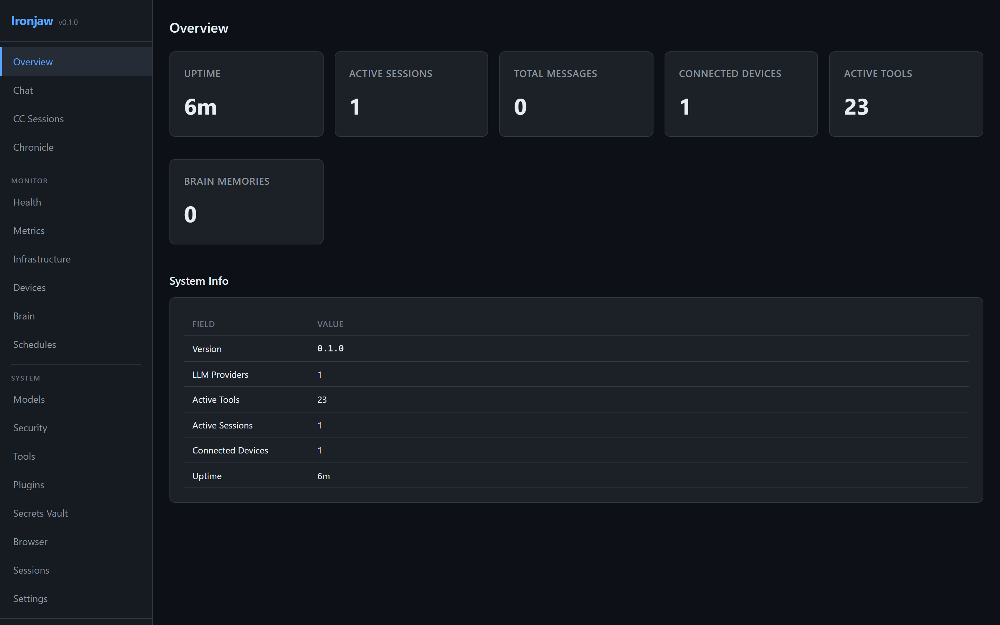

# Ironjaw

[](https://github.com/scaso01/ironjaw/actions/workflows/ci.yml)
[](LICENSE)
[](https://www.rust-lang.org)

A single-binary WebSocket gateway for building a personal AI assistant. It sits
between your clients and your models, and it owns the parts that are tedious to
get right: streaming, sessions that survive a reconnect, a permission model with
a human in the loop, long-term memory, and tool execution.

It talks to a local `llama-server` or any OpenAI-compatible endpoint, so the
whole thing can run on hardware you own with no per-token bill.

<p align="center">
  
</p>

## Why it exists

Most assistant stacks end up as a pile of Node services that each solve one
piece and none of which agree on state. Ironjaw replaces that with one Rust
binary and one SQLite file per concern. Sixteen crates, one process, one config
file.

The design goal throughout is that a dropped connection should not lose work.
Sessions persist, streams resume mid-token with a `catchup` frame, and a tool
call that was mid-flight when the socket died is still there when the client
comes back.

## Features

- **Protocol v4 over WebSocket**, 8 frame types (`req`, `res`, `stream`,
  `event`, `cmd`, `cmd.res`, `ui`, `ui.res`) and roughly 166 methods.
- **LLM router** with streaming, complexity-based model selection, and
  retry, failover and cache decorators stacked over any provider.
- **Persistent sessions** on SQLite WAL, with cursor pagination, automatic
  context compaction, and repair for sessions that were interrupted mid-write.
- **Four-tier permissions**, Auto, Notify, Confirm and MultiConfirm, with
  human-in-the-loop gates that fail closed on timeout.
- **Agentic tool loop**, executes model tool calls, feeds results back, and
  re-prompts until the model returns text. Emits `tool.start` and `tool.result`
  so a client can render progress.
- **RAG memory**, three context layers, hybrid retrieval over vectors and FTS5
  fused with RRF, a knowledge graph, temporal facts, salience decay, and
  maintenance agents that run while the system is idle.
- **MCP client and server**, expose the memory tools over stdio or a native
  Streamable HTTP endpoint, and consume external MCP servers.
- **OpenAI-compatible API**, drop-in `/v1/chat/completions`, `/v1/models` and
  `/v1/embeddings`.
- **Voice and vision**, STT via Whisper, TTS via Orpheus, image analysis and OCR.
- **Proactive engine**, a cron scheduler plus a workflow DAG executor.
- **Security layer**, SSRF protection, taint tracking, output scrubbing, secret
  leak detection, rate limiting and a loop guard.
- **Append-only audit trail**, every method call recorded in SQLite.

## Quick start

You need Rust 1.93 or newer. A local `llama-server` is optional; without one,
point the config at any OpenAI-compatible endpoint.

```bash
git clone https://github.com/scaso01/ironjaw.git
cd ironjaw
cp config/ironjaw.toml.example config/ironjaw.toml
```

Set an auth token. The config reads `${ENV_VAR}` placeholders, so keep the
secret out of the file:

```bash
export IRONJAW_AUTH_TOKEN="$(openssl rand -hex 18)"
cargo run -- config/ironjaw.toml
```

The gateway comes up on `:18794`. Check it:

```bash
curl -s localhost:18794/health
```

Other entry points:

```bash
cargo run -- --mcp-server config/ironjaw.toml   # MCP over stdio
cargo test --workspace                          # the test suite
```

<p align="center">
  
</p>

## Architecture

| Crate | Purpose |
|---|---|
| `ironjaw-core` | Binary entry point, TOML config, hot-reload watcher |
| `ironjaw-ws` | axum WebSocket server, Protocol v4 handlers, dashboard, mobile API, plugins, skills, hooks, agent graph, A2A, OpenAI compatibility |
| `ironjaw-security` | Permission tiers, HITL gates, rate limiting, sanitization, SSRF protection, taint tracking, leak detection |
| `ironjaw-audit` | Append-only SQLite audit trail |
| `ironjaw-llm` | Provider abstraction, complexity routing, retry and failover decorators, token accounting, JSON repair |
| `ironjaw-session` | Session and message storage, context compaction, session repair |
| `ironjaw-tools` | Trait-based tool registry, built-in tools, parallel executor |
| `ironjaw-brain` | RAG memory, hybrid search, knowledge graph, temporal facts, salience decay |
| `ironjaw-integrations` | Integration tools for search, infrastructure, Docker, ADB, git, Home Assistant and secrets |
| `ironjaw-proactive` | Cron scheduler and workflow DAG engine |
| `ironjaw-voice` | STT and TTS pipeline |
| `ironjaw-vision` | Image processing, OCR, multimodal analysis |
| `ironjaw-mcp` | MCP client and server |
| `ironjaw-cli` | Interactive REPL and status commands |
| `ironjaw-claude` | Coding-agent subprocess management and session sync |
| `ironjaw-tauri` | Desktop shell scaffolding |

## Endpoints

| Endpoint | Method | Description |
|---|---|---|
| `/ws` | WebSocket | Protocol v4, the primary interface |
| `/health` | GET | Health check with uptime |
| `/v1/chat/completions` | POST | OpenAI-compatible completion, streaming and not |
| `/v1/models` | GET | Model list in OpenAI format |
| `/v1/embeddings` | POST | Embeddings, proxied to the configured backend |
| `/api/dashboard/*` | GET/POST | Dashboard REST API |
| `/api/brain/*` | GET/POST | Memory browse, and an approval queue for pending memories |
| `/api/mobile/*` | GET/POST | Endpoints shaped for the Android client |
| `/mcp` | POST | Native MCP Streamable HTTP. Bearer token required except from loopback, and unregistered entirely when no token is set |

## Configuration

`config/ironjaw.toml.example` is the annotated reference. Every section is
optional except `[server]` and `[auth]`, and any value may be written as
`"${ENV_VAR}"` to keep secrets out of the file.

```toml
[server]
host = "127.0.0.1"
port = 18794

[auth]
token = "${IRONJAW_AUTH_TOKEN}"

[llm]
default_provider = "llama-server"

[brain]
enabled = false
embedding_url = "http://localhost:8080"
```

## Clients

[Dr. CLAW](https://github.com/scaso01/dr-claw-app) is the native Android client
for this gateway: Kotlin and Jetpack Compose, with the same Protocol v4
transport. The built-in web dashboard ships in `ironjaw-ws` and needs no
separate deployment.

## Documentation

| File | Contents |
|---|---|
| [`SETUP.md`](SETUP.md) | Installation and first-run configuration |
| [`docs/protocol-v4.md`](docs/protocol-v4.md) | Frame types and the full method reference |
| [`docs/subsystems.md`](docs/subsystems.md) | How the major subsystems fit together |
| [`docs/configuration.md`](docs/configuration.md) | Every config key |
| [`docs/project-structure.md`](docs/project-structure.md) | Crate layout |
| [`REQUIREMENTS.md`](REQUIREMENTS.md) | Feature requirements by phase |
| [`CHANGELOG.md`](CHANGELOG.md) | Version history |

## Testing

```bash
cargo test --workspace
```

The dashboard end-to-end suite drives a real browser against a running gateway,
so it is marked `#[ignore]` and excluded from the default run. To exercise it,
start a gateway, then:

```bash
export IRONJAW_AUTH_TOKEN="the token that gateway is running with"
cargo test -p ironjaw-ws --test dashboard_tests -- --ignored
```

Tests that shell out to `ripgrep` skip themselves when it is not installed
rather than failing, so a missing optional dependency never turns the suite red.

## License

AGPL-3.0-or-later. See [LICENSE](LICENSE).
